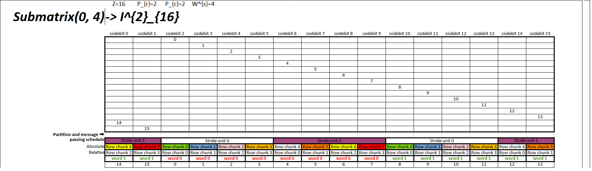
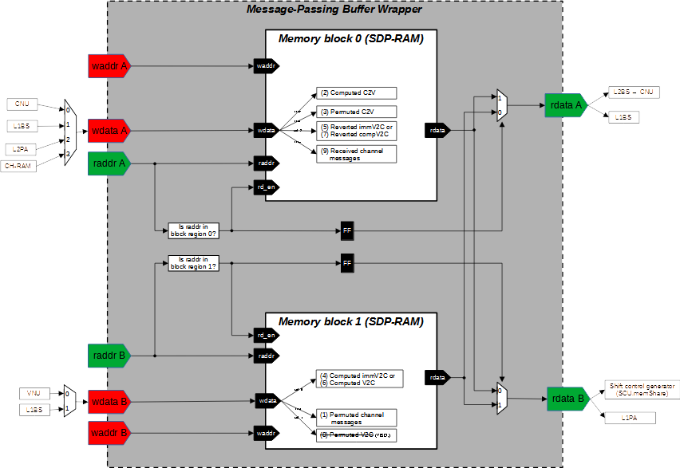
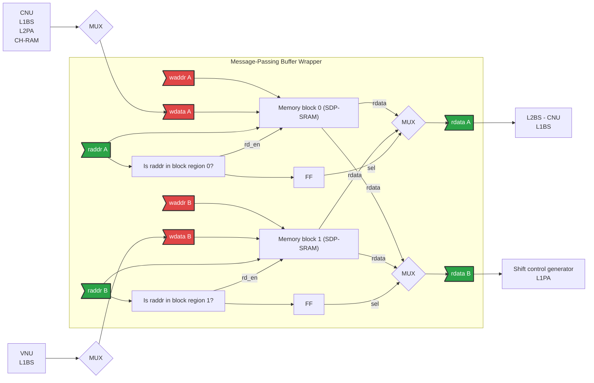

# Example of a submatrix partition

An example submatrix $I^{2}_{16}$ configured by $(Z=16, P_{r}=2, W^{s}=4)$, is partitioned as below.

# Design Premise

This work assumes the deployment of a reconfigurable interconnection network between the channel receiver datapath and the channel buffer. Such a network is necessitated by the requirement for dynamic topology adjustments to accommodate arbitrary stride patterns for submatrix partitioning. As the channel buffer is defined as the primary entry point for the decoder subsystem, the hardware realisation of the channel receiver and this reconfigurable interconnection network is beyond the scope of this work; however, their presence is assumed to ensure the delivery of correctly aligned data streams to the channel buffer interface.

# Architecture Design

The message-passing operation is executed by message-pass buffer and level-2 barrel shifter (L2BSs) and level-1 barrel shifters (L1BSs). Each of them is described as an independent subsystem, and its architecture and execution sequence are presented in the repsective subsection below.

> [!NOTE] For simplicity, the overall hardware description is based on the message quantisation fo **4 bits**.

## Level-1 Barrel Shifter (L1BS)

For a base-matrix column in the target QC-LDPC code, the number of parallel L1BS units is configured by $W^{s}$ and each of which is $P_{r}$ wide. Each L1BS deals with the circular shift of one row chunk that associates with $P_{r}$ extrinsic messages.

The L1BS subsytem is comprised of the hardware modules below
- Datapath
  - `behav_circular_shifter`
    - Source file: [${HDL_ROOT}/common_lib/barrel_shifter/qsn_bs.len_70.pipe3.q4/behav_circular_shifter.sv]()
  - `qsn_wrapper_len70_pipe3_q4`
    - Source file: [${HDL_ROOT}/common_lib/barrel_shifter/qsn_bs.len_70.pipe3.q4/qsn_wrapper_len70_pipe3_q4.v]()
  - `msgPass_l1bs`
    - Source file: [${HDL_ROOT}/msgPass_route_network/src/msgPass_l1bs.sv]()
- Control unit
  - `msgPass_l1bs_ctrl`
    - Source file: [**T.B.D.**], probably here: [${HDL_ROOT}/msgPass_route_network/src/msgPass_l1bs_ctrl.sv]()

The SystemVerilog parameters is summarised below.

  
<strong>Table 1. Configuration parameters.</strong>

| Parameter | Description |
|:----------|:------------|
| `MSG_WIDTH` | Message quantisation in bit for each input/output extrinsic message |
| `BS_LENGTH` | Length of barrel shifter inside one L1BS, i.e. corresponding to $P_{r}$ |
| `BS_NUM`    | Number of parallel L1BS units, i.e. corresponding to $W^{s}$ |
| `SHIFT_CTRL_WIDTH` | Bit width to represent the shift amount of one L1Bs unit | 

## Level-2 Barrel Shifter (L2BS)

During the L1BS phase, message-passing operations are executed across $W^{s}$ row chunks in parallel. The resulting shifted messages are immediately written back to their respective indexed blocks of the message-pass buffer, i.e. the $i$-th L1BS writes its output directly to the $i$-th block of the message-pass buffer for $i = 0, \dots, W^{s}-1$.

Due to this L1BS write-back policy, the row chunks stored across the buffer blocks may no longer align with the expected relative row-chunk indices required by the subsequent decoding layer (as relative row-chunk positions are implicitly shuffled during the L1BS phase). 

To restore correct alignment, a $W^{s}$-input multiplexer—designated as the Level-2 Barrel Shifter (L2BS)—is deployed at the output of the message-pass buffer. Each individual buffer block connects to its own independent L2BS multiplexer to reorder the outgoing row chunks. In summary, a single base-matrix column requires $W^{s}$ parallel L2BS units, each configured as a $W^{s}$-to-1 multiplexer, where every input port and the single output port is $P_{r} \times W$ bits wide, representing $P_{r}$ parallel extrinsic messages ($W$ bits each, corresponding to the `MSG_WIDTH` parameter).

- **Datapath**
  - `msgPass_l2bs`
    - Source file: [${HDL_ROOT}/msgPass_route_network/src/msgPass_l2bs.sv]()
- **Control Unit**
  - `msgPass_l2bs_ctrl`
    - Source file: [**T.B.D.**]

## Message-Pass Buffer

For every parallelised (or relative) base-matrix column in the target QC-LDPC code, the architecture provisions one dedicated message-pass buffer wrapper (RTL module: `msgPass_buffer_wrapper`). This wrapper acts as the central storage hub between the L1BS and L2BS routing phases, and functionally realises the message exchanges between check nodes and variable nodes. 

To satisfy the parallel routing requirements of the $W^{s}$ row chunks, each wrapper module is instantiated with $W^{s}$ independent memory blocks of message-pass buffers (RTL module: `msgPass_buffer`). Every memory block operates with a data port width of $P_{r} \times W$ bits, exactly accommodating the $P_{r}$ parallel extrinsic messages routed from the L1BS phase.

### Pseudo-True-Dual-Port Architecture

To ensure high-throughput message passing whilst optimising resource mapping on-chip, each of the $W^{s}$ memory blocks is implemented as a **pseudo-true-dual-port RAM**, designed to emulate the behaviour of a true-dual-port block RAM (BRAM) in Xilinx FPGAs.

Instead of relying strictly on native true-dual-port BRAM primitives or an equivalent SRAM hard macro (which can be resource-heavy or subject to synthesis constraints), this pseudo-true-dual-port architecture mimics true-dual-port behaviour. It provides two read and two write ports at the wrapper interface, by combining two underlying single-port RAM blocks with internal input/output multiplexing logic as illustrated below.

The physical storage inside each of these $W^{s}$ pseudo-true-dual-port units is divided into two distinct single-port memory blocks (Block 0 and Block 1), whose depths are derived statically from the core architecture parameters:

- **Memory Block 0 Depth:**  
  $$\text{Depth}_{0} = N_{\text{strd}} \times \left\lceil \frac{\max(d_c)}{P_c} \right\rceil \times (N_{\text{as\_max}} + \max(d_v) + 1)$$
  
- **Memory Block 1 Depth:**  
  $$\text{Depth}_{1} = N_{\text{strd}} \times \left\lceil \frac{\max(d_c)}{P_c} \right\rceil \times (N_{\text{as\_max}} + 1)$$

Where:
- $N_{\text{strd}}$ is the stride factor.
- $d_c$ and $d_v$ represent the check-node and variable-node degrees, respectively.
- $P_c$ defines the check-node processing parallelism.
- $N_{\text{as\_max}}$ represents the maximum number of decoding sub-iterations/layers.

> [!NOTE] The architecture generator is implemented in
> - [${PRJ_ROOT}/designs/rtl_gen/msgPass_buffer/memory_spec_generator.ipynb]().
> - Configured by a YAML file that collect all predefined architectural parameters, such as [${PRJ_ROOT}/designs/report/arch_param/nand_flash/ieee_1809_2018/ieee_1890_2018_flashMem_qcLdpc_annex_H_1kB_rate094_z140/arch_param.yaml]()

### Module Specifications

The architectural configuration parameters for the wrapper and its internal buffers are summarised below.

  
<strong>Table 2. Message-Pass Buffer Wrapper specifications.</strong>

| Parameter | Description |
|:----------|:------------|
| `wrapper_name` | `msgPass_buffer_wrapper` |
| `mem_bank_num` | Number of memory banks inside the wrapper, configured to $W^{s}$ |
| `port_width`   | $P_{r} \times W$ bits (representing $P_{r}$ extrinsic messages of `MSG_WIDTH` bits each) |
| `rd_port_num`  | 2 (enabled via the pseudo-true-dual-port multiplexing logic) |
| `wr_port_num`  | 2 (enabled via the pseudo-true-dual-port multiplexing logic) |
| `total_depth`  | $\text{Depth}_{0} + \text{Depth}_{1}$ |

- **Datapath**
  - `msgPass_buffer`
    - Source file:  [${HDL_ROOT}/message_pass_buffer/src/msgPass_buffer.sv]()
  - `msgPassBuf_in_glue`
    - Source file:  [${HDL_ROOT}/message_pass_buffer/src/msgPassBuf_in_glue.sv]()
  - `msgPassBuf_out_glue`
    - Source file:  [${HDL_ROOT}/message_pass_buffer/src/msgPassBuf_out_glue.sv]()
  - `msgPass_buffer_wrapper`
    - Source file:  [${HDL_ROOT}/message_pass_buffer/src/msgPass_buffer_wrapper.sv]()
- **Control Unit**
  - [!T.B.D.]: Managed by the parent network controller or distributed write-enable (`we_in`/`we_out`) routing signals.

